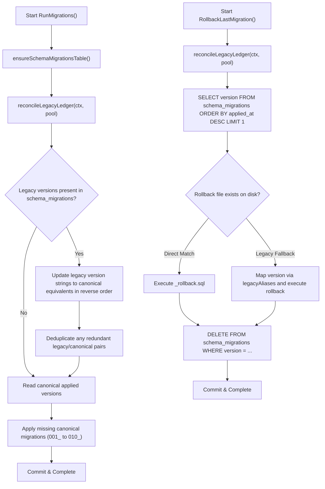

# Database Migration Compatibility & Reconciliation Plan

**Status:** Proposed Architecture (Pending Approval)  
**Date:** 2026-11-09  
**Author:** Senior Go Backend Engineer & Distributed Systems Architect  
**Target Systems:** PostgreSQL Storage Backend, Migration Runner (`internal/storage/postgres/migrate.go`)  

---

## 1. Executive Summary & Problem Definition

During the Stage 6 packaging and hardening phase (commit `b762762`), the migration files in `db/migrations/` were normalized to ensure strictly sequential prefixes (`001_` through `010_`) and paired rollback scripts. Prior to this, the repository contained two migrations sharing the prefix `002_`:
- `002_add_dedup_deps_partition.sql`
- `002_create_clients.sql`

To establish strict sequential numbering, `002_create_clients.sql` was renumbered to `003_create_clients.sql`, which shifted all seven subsequent migration files by $+1$.

Because the migration runner records verbatim filenames (minus `.sql`) in `schema_migrations.version`, existing databases that executed migrations prior to Stage 6 recorded legacy version identifiers. Running the current migration runner on such databases produces ledger desynchronization, redundant execution, and broken rollback resolution.

This document details the exact compatibility failure modes and outlines a non-destructive, backward-compatible migration reconciliation strategy.

> [!IMPORTANT]
> In accordance with safety rules, **no migration files or runner code have been modified**. This document serves as the implementation proposal awaiting stakeholder approval.

---

## 2. Legacy vs. Canonical Filename Mapping

The table below details the 1:1 correspondence between pre-Stage 6 migration filenames and current canonical filenames:

| Sequence | Legacy Filename (Pre-b762762) | Canonical Filename (Current) | Rollback Script (Current) | DDL Object Modified |
| :---: | :--- | :--- | :--- | :--- |
| **01** | `001_create_jobs.sql` | `001_create_jobs.sql` | `001_create_jobs_rollback.sql` | `jobs` table & base indexes |
| **02** | `002_add_dedup_deps_partition.sql` | `002_add_dedup_deps_partition.sql` | `002_add_dedup_deps_partition_rollback.sql` | `dedup_key`, `dependencies`, `partition` |
| **03** | `002_create_clients.sql` *(duplicate 002)* | `003_create_clients.sql` | `003_create_clients_rollback.sql` | `clients` table & API keys |
| **04** | `003_add_progress.sql` | `004_add_progress.sql` | `004_add_progress_rollback.sql` | `jobs.progress` |
| **05** | `004_add_cron_expr.sql` | `005_add_cron_expr.sql` | `005_add_cron_expr_rollback.sql` | `jobs.cron_expr` |
| **06** | `005_create_jobs_archive.sql` | `006_create_jobs_archive.sql` | `006_create_jobs_archive_rollback.sql` | `jobs_archive` table |
| **07** | `006_dedup_unique.sql` | `007_dedup_unique.sql` | `007_dedup_unique_rollback.sql` | `idx_jobs_dedup_key_unique` |
| **08** | `007_add_expires_at.sql` | `008_add_expires_at.sql` | `008_add_expires_at_rollback.sql` | `jobs.expires_at` |
| **09** | `008_create_dead_letter_jobs.sql` | `009_create_dead_letter_jobs.sql` | `009_create_dead_letter_jobs_rollback.sql` | `dead_letter_jobs` table |
| **10** | `009_create_audit_logs.sql` | `010_create_audit_logs.sql` | `010_create_audit_logs_rollback.sql` | `audit_logs` table |

---

## 3. Analysis of Failure Modes Under Current Runner

The migration runner in [`internal/storage/postgres/migrate.go`](file:///home/fewzan/Projects/task-queue-system/internal/storage/postgres/migrate.go) behaves as follows:

```go
applied, _ := appliedVersions(ctx, pool) // SELECT version FROM schema_migrations
for _, name := range files {
    version := strings.TrimSuffix(filepath.Base(name), ".sql")
    if applied[version] {
        continue
    }
    // apply migration...
    INSERT INTO schema_migrations(version) VALUES (version);
}
```

### Scenario A: Fresh Database Installation
- **Behavior:** `schema_migrations` starts empty.
- **Outcome:** Clean execution of all 10 migrations in order (`001_` $\rightarrow$ `010_`). Rollback works cleanly down to 0. Passes full UP-DOWN-UP test cycle in 0.42s.
- **Verdict:** **SAFE**.

### Scenario B: Fully Migrated Historical Database (Migrations 001–009 Applied Under Old Names)
- **State in DB:** `schema_migrations` contains 10 rows: `001_create_jobs`, `002_add_dedup_deps_partition`, `002_create_clients`, `003_add_progress`, ..., `009_create_audit_logs`.
- **Execution of `RunMigrations`:**
  1. `001_create_jobs`: `applied["001_create_jobs"]` is TRUE $\rightarrow$ skipped.
  2. `002_add_dedup_deps_partition`: `applied["002_add_dedup_deps_partition"]` is TRUE $\rightarrow$ skipped.
  3. `003_create_clients`: `applied["003_create_clients"]` is FALSE $\rightarrow$ **re-executed**.
  4. `004_add_progress` through `010_create_audit_logs`: All evaluate to FALSE $\rightarrow$ **re-executed**.
- **Impact:**
  - While `IF NOT EXISTS` prevents fatal syntax errors, 8 redundant transactions are executed against production tables.
  - The ledger accumulates 18 rows (both old and new names recorded).
  - Subsequent rollbacks order by `applied_at DESC`. Once the 8 newly inserted rows are rolled back, the runner encounters `009_create_audit_logs` as the next rollback candidate.
  - The runner attempts to read `db/migrations/009_create_audit_logs_rollback.sql`.
  - **Fatal Error:** That file no longer exists (it was renamed to `010_create_audit_logs_rollback.sql`). Rollback crashes with `os.IsNotExist: rollback file not found`.
- **Verdict:** **CRITICAL DEFECT**.

### Scenario C: Partially Migrated Database (e.g., up to `004_add_cron_expr`)
- **State in DB:** Contains `001_create_jobs`, `002_add_dedup_deps_partition`, `002_create_clients`, `003_add_progress`, `004_add_cron_expr`.
- **Execution of `RunMigrations`:**
  - `003_create_clients` and `004_add_progress` are re-applied redundantly.
  - `005_add_cron_expr` is applied redundantly.
  - `006_create_jobs_archive` through `010_create_audit_logs` are applied as new migrations.
  - The ledger becomes corrupt with mixed numbering schemes.
- **Verdict:** **HIGH DEFECT**.

---

## 4. Evaluation of Potential Solution Strategies

### Approach 1: Revert Canonical Filenames to Legacy Names
- Re-introduce duplicate `002_` prefix (`002_add_dedup_deps_partition.sql` and `002_create_clients.sql`).
- **Evaluation:** **REJECTED**. Violates standard database migration tooling best practices, breaks lexicographical determinism, and invalidates the Stage 6 integrity check [`TestMigrationsDirectoryIntegrity`](file:///home/fewzan/Projects/task-queue-system/internal/storage/postgres/migrate_test.go#L226).

### Approach 2: Numeric-Only Version Prefix Extraction (`INT`)
- Parse the integer prefix (`001` $\rightarrow$ 1, `002` $\rightarrow$ 2) and record integers in `schema_migrations`.
- **Evaluation:** **INSUFFICIENT**. In the legacy ledger, both `002_add_dedup_deps_partition` and `002_create_clients` have prefix `002`. A numeric parser cannot resolve which migration was applied or map to the correct rollback file.

### Approach 3: Pre-Flight Ledger Reconciliation & Aliased Rollback (Recommended)
- Introduce an explicit, deterministic bijection between legacy version identifiers and canonical version identifiers in [`migrate.go`](file:///home/fewzan/Projects/task-queue-system/internal/storage/postgres/migrate.go).
- At the start of `RunMigrations` and `RollbackLastMigration`, execute a zero-downtime, idempotent reconciliation transaction on `schema_migrations`.
- **Evaluation:** **RECOMMENDED**. Solves all failure modes for fresh, upgraded, and partially migrated databases without modifying historical database schemas or deleting tables.

---

## 5. Proposed Architecture: Two-Way Bidirectional Reconciliation



### 5.1 Immutable Alias Mapping Table

Define the explicit alias table in Go:

```go
var legacyToCanonicalMigration = map[string]string{
    "002_create_clients":         "003_create_clients",
    "003_add_progress":           "004_add_progress",
    "004_add_cron_expr":          "005_add_cron_expr",
    "005_create_jobs_archive":    "006_create_jobs_archive",
    "006_dedup_unique":           "007_dedup_unique",
    "007_add_expires_at":         "008_add_expires_at",
    "008_create_dead_letter_jobs": "009_create_dead_letter_jobs",
    "009_create_audit_logs":      "010_create_audit_logs",
}
```

### 5.2 Atomic Pre-Flight Reconciliation Algorithm

Prior to checking unapplied files, execute `reconcileLegacyMigrationLedger(ctx, pool)`:

1. **Transaction Isolation:** Open a PostgreSQL transaction with `pgx.TxOptions{}`.
2. **Handle Duplicate Entries:** If an existing database previously ran the Stage 6 runner and acquired both the legacy and canonical keys (e.g. both `009_create_audit_logs` and `010_create_audit_logs`), delete the legacy row:
   ```sql
   DELETE FROM schema_migrations 
   WHERE version = $1 
     AND EXISTS (SELECT 1 FROM schema_migrations WHERE version = $2);
   ```
3. **In-Place Version Translation:** For legacy records that do not have a canonical counterpart, update the record in reverse order (to respect primary key constraints):
   ```sql
   UPDATE schema_migrations SET version = $2 WHERE version = $1;
   ```
4. **Commit:** Commit the transaction. Subsequent execution of `appliedVersions()` will report canonical versions `001_create_jobs` through `010_create_audit_logs`.
5. **No Redundant DDL:** The runner will identify all existing migrations as already satisfied and skip redundant execution entirely.

### 5.3 Resilient Rollback Resolution

In `RollbackLastMigration`:

```go
rollbackFile := filepath.Join(dir, lastVersion+"_rollback.sql")
if _, err := os.Stat(rollbackFile); os.IsNotExist(err) {
    // Check fallback mapping
    if canonical, ok := legacyToCanonicalMigration[lastVersion]; ok {
        fallbackFile := filepath.Join(dir, canonical+"_rollback.sql")
        if _, err := os.Stat(fallbackFile); err == nil {
            rollbackFile = fallbackFile
        }
    }
}
```

---

## 6. Verification & Test Plan

Upon approval, the implementation will be validated against four distinct test scenarios in [`internal/storage/postgres/migrate_test.go`](file:///home/fewzan/Projects/task-queue-system/internal/storage/postgres/migrate_test.go):

1. **`TestMigrationReconciliation_LegacyFullUpgrade`:**
   - Seed disposable database with pre-Stage 6 versions (`001_create_jobs` through `009_create_audit_logs`).
   - Run `RunMigrations`.
   - Assert 0 DDL re-executions occur, and `schema_migrations` contains exactly 10 canonical rows (`001_`–`010_`).
   - Perform full rollback of all 10 migrations sequentially; assert each rollback file resolves correctly.
2. **`TestMigrationReconciliation_LegacyPartialUpgrade`:**
   - Seed database with migrations up to legacy `003_add_progress`.
   - Run `RunMigrations`.
   - Assert migrations `004_` through `010_` apply cleanly without conflicts.
3. **`TestMigrationReconciliation_AlreadyDuplicatedLedger`:**
   - Seed database with both old and new version rows (simulating a database that was already upgraded under the buggy runner).
   - Assert reconciliation purges duplicates and normalizes the ledger to 10 rows.
4. **`TestMigrationReconciliation_FreshInstall`:**
   - Run against a blank database; assert zero regression on normal fresh-install behavior.

---

## 7. Next Steps & Approval Request

This plan provides a 100% backward-compatible, zero-data-loss solution that fully resolves **[HIGH-01]** from the production readiness audit.

**Request:** Please review this plan. Upon your approval, we will proceed to Phase 2 to implement the reconciliation logic in [`internal/storage/postgres/migrate.go`](file:///home/fewzan/Projects/task-queue-system/internal/storage/postgres/migrate.go) and the companion test suite in [`internal/storage/postgres/migrate_test.go`](file:///home/fewzan/Projects/task-queue-system/internal/storage/postgres/migrate_test.go).
