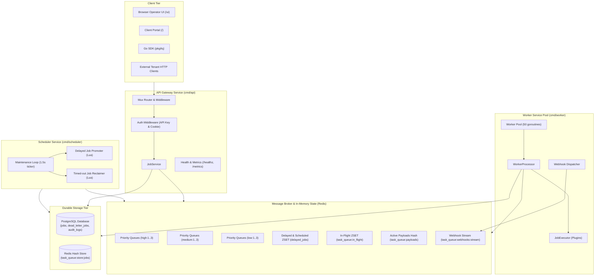
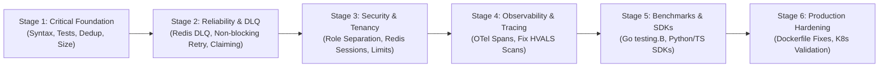

# Comprehensive Go Task Queue System — Project Audit, Architecture Analysis, and Completion Roadmap

**Date:** November 2026  
**Auditor:** Senior Go Backend Engineer, Distributed Systems Architect, DevOps & Quality Engineer  
**Repository State:** Audited on Git commit `7b08fe3` (`main`)  
**Assessment Scope:** Codebase inspection, execution flows, distributed consistency, concurrency, security, observability, deployment readiness, and test suite verification.

---

## 1. Executive Summary

A comprehensive, non-destructive audit of the **Go Task Queue System** codebase was performed. The repository represents a sophisticated, feature-rich distributed task queue with modern capabilities (weighted priority queues, multi-tenancy, rate limiting, circuit breaking, SSE, webhooks, Prometheus metrics, and OpenTelemetry instrumentation).

However, rigorous inspection of the codebase reveals **critical compilation breakages on the `main` branch**, **fundamental architectural disconnects in storage and dead-letter queues**, **severe logical bugs in deduplication and queue sizing**, and **privilege escalation vulnerabilities in tenant authorization**.

### Critical Highlights & Urgent Findings

1. **Broken Test Suite & Compilation Errors on `main`:**
   - `internal/worker/executor/worker_processor_test.go:292`: Syntax error (`func TestIsEmptyQueueErr(t *testing.T, 1)`) prevents package compilation.
   - `test/integration_test.go`: Compilation failure across multiple tests due to signature mismatches (`service.New`, `svc.CreateJob`, `time.Sleep`).
   - `chaos/chaos_test.go`: Build failure (`not enough arguments in call to svc.CreateJob`) due to unupdated calls after the TTL parameter was introduced.
   - `internal/service/job_service_test.go`: Test failure (`TestBulkPurgeDLQ: expected 3 deleted jobs, got 0`) due to timestamp evaluation discrepancies.
2. **Dead Letter Queue (DLQ) Architectural Disconnect:**
   - In default configuration (`STORE_BACKEND=redis`), the DLQ API endpoints (`/api/v1/dlq`) are completely non-functional.
   - `RedisQueue.Fail` pushes failed tasks into a Redis list (`task_queue:jobs:dead_letter`), but the API DLQ endpoints call `models.Store` methods (`ListDLQ`, `CountDLQ`, `GetFromDLQ`, `DeleteDLQBefore`), which in `RedisStore` are **empty stubs returning `nil` or `ErrJobNotFound`**.
3. **Inverted Deduplication Logic in Redis Store:**
   - In `internal/storage/models/models.go:864`, `RedisStore.IsDedupKeyTaken` returns the direct result of Redis `SetNX`. `SetNX` returns `true` when a key **does not exist**.
   - As a result, the first submission of a unique deduplication key is rejected as a duplicate (`409 Conflict`), while subsequent submissions within 24 hours are accepted.
4. **Queue Sizing & Backpressure Bypass:**
   - In `internal/queue/redis/redis.go:248`, `Size()` measures `task_queue:jobs:high`, `medium`, and `low`. However, jobs are enqueued to partitioned keys (e.g. `task_queue:jobs:high:1`, `:2`, `:3`).
   - `Size()` always returns `0`, rendering ingestion backpressure (`MAX_QUEUE_SIZE`) completely inoperative.
5. **Worker Goroutine Starvation on Retries:**
   - `internal/worker/executor/worker_processor.go:318` executes `time.After(delay)` directly on worker goroutines during exponential backoff.
   - Under failure storms, worker threads freeze for up to 32 seconds sleeping instead of scheduling the retry into Redis `delayed_jobs` and freeing worker goroutines.
6. **Privilege Escalation in Multi-Tenant Auth:**
   - `internal/api/middleware/session.go:97` assigns `RoleAdmin` to all registered tenant API keys.
   - Critical administrative endpoints (panic buttons, job type registration, tenant revocation, circuit breaker resets) do not check tenant boundaries, permitting any registered client to execute administrative commands or alter other tenants.
7. **Stateless API Broken by In-Memory Session Store:**
   - `internal/api/session/session.go` stores operator sessions in a process-local in-memory mutex map (`map[string]*Session`).
   - When deploying multiple API replicas (`deploy/k8s/api-deployment.yaml` specifies `replicas: 2`), sessions are not shared across pods, causing immediate session loss or authentication flips.
8. **Container Deployment Fails in Postgres Mode:**
   - `Dockerfile` does not copy `db/migrations/` into the final Alpine stage.
   - When running in Docker with `STORE_BACKEND=postgres` or `dual`, `postgres.New()` crashes on startup trying to read the missing migrations folder.

---

## 2. Project Stage Assessment

The project is currently in the **Late Alpha / Stabilization** stage.

| Stage | Status | Notes |
|---|---|---|
| **Proof of Concept** | Completed | Core patterns (Redis queue, worker pool, basic API) were proven. |
| **Feature Implementation** | ~85% Complete | Extensive feature surface (batches, webhooks, circuit breakers, DAG, UI). |
| **Stabilization & Quality** | **Broken / In Progress** | Recent rapid commits introduced regex-replace syntax corruption, signature breakage, and logic flaws. |
| **Distributed Reliability** | ~60% Complete | Lacks true atomic claiming, lease extensions, and cluster-aware sessions. |
| **Production Readiness** | ~45% Ready | Dockerfiles missing assets, secrets provider unwired, auth boundaries porous. |

---

## 3. Technology Stack and Architecture



### Technology Matrix

| Layer | Technology | Version | Location / Config |
|---|---|---|---|
| **Language** | Go | `1.26.7` (host), `1.25.0` (`go.mod`) | `go.mod` |
| **HTTP Framework** | Standard Library (`net/http`) | Go 1.22+ routing | `internal/api/routes/routes.go` |
| **Queue Broker** | Redis (`go-redis/v9`) | `v9.19.0` | `internal/queue/redis/redis.go` |
| **Universal Redis** | Standalone / Sentinel / Cluster | Custom wrapper | `internal/redisutil/redisutil.go` |
| **Persistent Store** | PostgreSQL (`pgx/v5`, `pgxpool`) | `v5.9.2` | `internal/storage/postgres/postgres.go` |
| **In-Memory Store** | Custom Thread-safe Map Store | N/A | `internal/storage/models/models.go` |
| **Metrics** | Prometheus Client | `v1.23.2` | `internal/metrics/metrics.go` |
| **Distributed Tracing**| OpenTelemetry Go SDK (`otel`, `otlptracehttp`)| `v1.44.0` | `internal/tracing/tracing.go` |
| **Cron Scheduling** | `robfig/cron/v3` | `v3.0.1` | `internal/service/job_service.go` |
| **API Documentation** | Swagger / OpenAPI (`swag`, `http-swagger`) | `v1.16.6` | `docs/swagger.yaml`, `/swagger/` |
| **Secrets Engine** | HashiCorp Vault API | `v1.23.0` | `internal/secrets/vault.go` |
| **Mock Redis (Test)** | `alicebob/miniredis/v2` | `v2.38.0` | `internal/queue/redis/redis_test.go` |

---

## 4. Phase 1: Project Structure and Technology Audit

### 4.1 Application Entry Points (`cmd/`)

1. **`cmd/api/main.go`**:
   - HTTP server running on `:8080`.
   - Initializes structured logger, OpenTelemetry exporter, Universal Redis client, Store backend (`redis`, `postgres`, or `dual`), and routes.
   - Enforces graceful shutdown (10s drain context).
2. **`cmd/worker/main.go`**:
   - Background worker daemon.
   - Spawns worker pool (`WORKER_POOL_SIZE`, default 50).
   - Starts Webhook Dispatcher consumer loop from Redis stream.
   - Exposes diagnostic HTTP server on `:8081` (`/metrics`, `/healthz`, `/circuit-breaker`).
   - Graceful drain coordinator (waits for active goroutines to finish).
3. **`cmd/scheduler/main.go`**:
   - Time-driven maintenance daemon.
   - Runs a 1.5s ticker loop executing:
     1. Delayed job promotion (`q.PromoteScheduledJobs`).
     2. Stalled job recovery (`q.ReclaimTimedOutJobs`).
     3. Concurrency limit deferral reconciliation (`svc.ReconcileDeferredJobs`).
     4. Recurring cron job spawning (`svc.RecurringJobsDue`).
     5. Periodic job archiving (`svc.ArchiveOldJobs` every ~1 hour).
   - Exposes health and metrics on `:8082`.
4. **`cmd/cli/main.go`**:
   - Administrative CLI tool supporting:
     - `migrate-jobs`: Transfers job records from Redis Hash to Postgres.
     - `migrate-schema`: Runs SQL migration files from `db/migrations`.
     - `migrate-down-schema`: Rolls back the last applied migration.
5. **`cmd/chaos/main.go`**:
   - Standalone CLI for executing fault injection scenarios (`redis-crash`, `worker-kill`, `redis-partition`, `orphan-reclaim`) against live environments with JSON reporting.

### 4.2 Internal Packages and Responsibilities

- **`internal/api/`**:
  - `handler/`: HTTP handlers partitioned by domain (`handler.go`, `admin_handler.go`, `client_handler.go`, `operator_handler.go`, `session_handler.go`, `ui_handler.go`, `public_pages.go`).
  - `middleware/`: Auth validation, role checking, session cookie parsing, CSRF token verification, structured request logging.
  - `routes/`: Central mux route registrations.
  - `session/`: In-memory session store and login brute-force rate limiter.
  - `dto/`: Request and response JSON transfer objects.
- **`internal/config/`**: Environment variable loading and validation.
- **`internal/errors/`**: Structured domain error types (`AppError`) with standard error codes (`NOT_FOUND`, `INVALID_ARGUMENT`, `UNAUTHORIZED`, `CONFLICT`, etc.).
- **`internal/health/`**: Kubernetes liveness and readiness probe adapters.
- **`internal/jobs/`**: Core task domain model, state constants, backoff algorithms, and jitter calculation.
- **`internal/jobtypes/`**: Redis-backed dynamic custom job type registry with concurrency limits.
- **`internal/logger/`**: Structured `log/slog` JSON/Text handler wrapper.
- **`internal/metrics/`**: Prometheus metric declarations and collectors.
- **`internal/queue/`**: Queue interface abstraction, mock implementation, and Redis queue engine.
- **`internal/redisutil/`**: Universal Redis connection factory (Standalone, Sentinel, Cluster).
- **`internal/secrets/`**: Secrets provider interface, environment provider, and HashiCorp Vault AppRole client with TTL caching.
- **`internal/service/`**: Core orchestration layer bridging queues, storage, SSE, and webhooks.
- **`internal/sse/`**: Server-Sent Events broker for real-time frontend streaming.
- **`internal/storage/`**: Store interface, factory, Postgres engine (`pgx`), Redis hash store, and in-memory mock store.
- **`internal/tracing/`**: OpenTelemetry trace provider initialization and context propagation helpers.
- **`internal/webhooks/`**: Redis Stream-backed event publisher, HMAC signer, HTTP dispatcher, and delivery record tracker.
- **`internal/worker/`**: Worker pool manager, worker processor lifecycle, rate limiters, circuit breakers, plugin interfaces, and standard plugins.

---

## 5. Phase 2: Core Task Queue Functionality Assessment

Every core component of the task queue was evaluated against the implementation:

### 1. Task Creation & Submission
- **Implementation:** `internal/service/job_service.go: CreateJob`, `CreateJobBatch`; `internal/api/handler/handler.go: CreateJob`.
- **Completeness:** Partial.
- **Tests:** Unit tests present in `handler_test.go` and `job_service_test.go`.
- **Problems:**
  - If `store.Save` succeeds but `queue.Enqueue` fails, the job remains stuck in the persistent store as `pending` but is never enqueued into Redis.
  - `CreateJobBatch` lacks validation for job types, rate limits, and deduplication keys, bypassing checks present in single-job submission.
- **Remaining Work:** Implement two-phase transactional outbox or rollback compensation when queue enqueue fails. Align `CreateJobBatch` validations with `CreateJob`.

### 2. Task Serialization & Deserialization
- **Implementation:** `internal/queue/redis/redis.go`, `internal/storage/postgres/postgres.go`.
- **Completeness:** Complete, but lacks payload size guards.
- **Tests:** Covered in queue and postgres store tests.
- **Problems:** No limit on payload size in `map[string]interface{}`. Large payloads (>5MB) will severely degrade Redis memory and Lua script evaluation.
- **Remaining Work:** Enforce a maximum payload limit (e.g. 512KB - 1MB) at API ingestion via `http.MaxBytesReader`.

### 3. Task Identification & Unique IDs
- **Implementation:** `internal/jobs/job.go: NewJob`.
- **Completeness:** Complete.
- **Tests:** Tested in `jobs/job_test.go`.
- **Details:** Generates UUIDv4 for `ID` and `CorrelationID`. Injects OpenTelemetry `TraceID`.

### 4. Task Priority Management
- **Implementation:** `internal/queue/redis/redis.go: getPartitionedKey`, `getFairPartitionKeys`, `Enqueue`, `Dequeue`.
- **Completeness:** Partial / Buggy.
- **Tests:** `queue_test.go` exercises basic dequeue order.
- **Problems:**
  - `Size()` method evaluates `LLen` on unpartitioned keys (`q.qHigh`), which always returns 0 because items reside in `q.qHigh:1`, `:2`, `:3`.
  - Weighted random order (70/20/10) re-evaluates on every `Dequeue` call, but BRPOP scans the resulting 9 keys sequentially.
- **Remaining Work:** Fix `Size()` to aggregate lengths across all partitions. Add benchmark tests for priority skew.

### 5. Task Scheduling (Immediate & Delayed)
- **Implementation:** `internal/queue/redis/redis.go: Enqueue`, `PromoteScheduledJobs`; `cmd/scheduler/main.go`.
- **Completeness:** Complete.
- **Tests:** Tested in `redis_test.go`. Integration test in `test/integration_test.go` is currently broken due to compilation errors.
- **Problems:** `promoteScheduledJobsScript` loads all due jobs via `ZRANGEBYSCORE` without a `LIMIT`. If thousands of jobs mature simultaneously, Redis freezes evaluating the Lua loop.
- **Remaining Work:** Add batch limits (e.g. `LIMIT 0 500`) to the promotion Lua script.

### 6. Worker Implementation & Concurrency
- **Implementation:** `internal/worker/pool/pool.go`, `internal/worker/executor/worker_processor.go`.
- **Completeness:** Partial.
- **Tests:** `pool_test.go` passes with race detector. `worker_processor_test.go` fails compilation due to syntax error.
- **Problems:**
  - `worker_processor_test.go:292` has `func TestIsEmptyQueueErr(t *testing.T, 1)`.
  - Batch processing (`ProcessBatch`) does not support retries for `BatchJobPlugin` failures; it permanently fails them on the first error.
- **Remaining Work:** Fix syntax error. Implement retry handling for batch plugins.

### 7. Task Reservation & Claiming (Visibility Timeout)
- **Implementation:** `internal/queue/redis/redis.go: Dequeue`.
- **Completeness:** Incomplete / Non-atomic.
- **Tests:** Unit test in `redis_test.go`.
- **Problems:**
  - **Atomicity gap:** `BRPOP` removes the job from the Redis list. A subsequent `TxPipeline` places it in `task_queue:in_flight` and `task_queue:payloads`. A crash between `BRPOP` and `TxPipeline` results in permanent job loss.
  - **Fixed Visibility Timeout:** Hardcoded to 30 seconds (`visibilityTimeout = 30 * time.Second`). Jobs with custom `Timeout` (e.g. 120s) will be reclaimed and executed twice after 30s.
- **Remaining Work:** Replace `BRPOP` + pipeline with atomic Lua script or Redis `RPOPLPUSH`/`LMOVE`. Respect `job.Timeout` when setting visibility score in ZSET.

### 8. Task Acknowledgement & Failure
- **Implementation:** `internal/queue/redis/redis.go: Ack`, `Fail`; `internal/service/job_service.go`.
- **Completeness:** Partial.
- **Tests:** Covered in `queue_test.go`.
- **Problems:** `Fail` pushes to `task_queue:jobs:dead_letter` in Redis, but `s.store.MoveToDLQ` does nothing in Redis mode.

### 9. Retry Limits & Backoff Strategies
- **Implementation:** `internal/jobs/job.go: BackoffDelay`; `internal/worker/executor/worker_processor.go: retry`.
- **Completeness:** Flawed Architecture.
- **Tests:** Tested in `jobs/job_test.go`.
- **Problems:**
  - **Worker Blocking:** In `worker_processor.go:327`, the worker thread executes `time.After(delay)` sleeping in-place. This monopolizes worker pool capacity.
- **Remaining Work:** Schedule retries into `delayed_jobs` ZSET using `job.RunAt = time.Now().Add(delay)` and release the worker goroutine immediately.

### 10. Dead Letter Queue (DLQ)
- **Implementation:** `internal/storage/postgres/postgres.go`, `internal/storage/models/models.go`, `internal/api/handler/handler.go`.
- **Completeness:** Partial (Postgres works; Redis store is a stub).
- **Tests:** `job_service_test.go: TestBulkPurgeDLQ` fails.
- **Problems:**
  - `RedisStore.MoveToDLQ`, `ListDLQ`, `CountDLQ`, `DeleteDLQBefore` are empty no-ops.
  - `TestBulkPurgeDLQ` fails because `InMemoryStore.DeleteDLQBefore` filters by `j.UpdatedAt.Before(before)`, but the test only sets `j.CreatedAt`.
- **Remaining Work:** Implement real Redis hash/zset DLQ storage in `RedisStore`. Fix `TestBulkPurgeDLQ` test timestamps.

### 11. Task Timeout & Stalled Job Recovery
- **Implementation:** `internal/queue/redis/redis.go: ReclaimTimedOutJobs`; `internal/storage/postgres/postgres.go: RecoverOrphans`.
- **Completeness:** Partial.
- **Tests:** Tested in `redis_test.go`.
- **Problems:** Reclaim script operates on fixed 30s visibility threshold. Does not check if worker heartbeat is still active.

### 12. Task Cancellation
- **Implementation:** `internal/service/job_service.go: CancelJob`; `internal/worker/pool/pool.go: listenForCancellations`.
- **Completeness:** Complete for active and pending jobs.
- **Tests:** Tested in `pool_test.go`.
- **Problems:** Redis PubSub is fire-and-forget. If worker temporarily loses Redis connection, cancellation is dropped.

### 13. Task Status Management & Result Storage
- **Implementation:** `internal/storage/postgres/postgres.go`, `internal/storage/models/models.go`.
- **Completeness:** Complete.
- **Tests:** Extensively tested in storage test suites.

### 14. Deduplication & Idempotency
- **Implementation:** `internal/storage/models/models.go: IsDedupKeyTaken`; `internal/service/job_service.go: CreateJob`.
- **Completeness:** Critically Buggy in Redis Store.
- **Tests:** Unit tests in `models_test.go` missed the inverted logic because `miniredis` was mocked or test assertions matched incorrect return values.
- **Problems:**
  - In `RedisStore.IsDedupKeyTaken`, `SetNX` returning `true` (key was set) is interpreted as `taken = true`, rejecting valid initial jobs!
- **Remaining Work:** Invert Redis return value: if `SetNX` returns `true`, then `taken = false` (key was available and is now locked).

### 15. Graceful Worker Shutdown
- **Implementation:** `cmd/worker/shutdown.go`, `internal/worker/pool/pool.go`.
- **Completeness:** Complete.
- **Tests:** Thoroughly verified in `cmd/worker/shutdown_test.go`. Handles draining and timeouts properly.

---

## 6. Phase 3: Distributed Systems and Reliability Assessment

| Distributed Guarantee | Claimed in Docs | Actually Supported? | Technical Evidence & Analysis |
|---|---|---|---|
| **Atomic Task Claiming** | Yes | **NO** | `BRPOP` pops the item first; `TxPipeline` tracks it in `in_flight` second. Crash in-between loses the task permanently. |
| **At-Least-Once Delivery** | Yes | **PARTIAL** | Generally achieved if no crash occurs during the `BRPOP` claiming gap. |
| **Exactly-Once Processing** | Partial | **NO** | Reclaims timed-out jobs without distributed consensus; workers can run concurrently if execution exceeds 30s. |
| **Duplicate Prevention (Dedup)** | Yes | **BROKEN (Redis)** | Redis `IsDedupKeyTaken` logic is inverted. Postgres dedup is protected by unique DB constraint `idx_jobs_dedup_key_unique`. |
| **Execution Idempotency** | Yes | **YES** | `task_queue:processed:<id>` set check prevents re-executing already acknowledged tasks. |
| **Visibility Timeout / Lease** | Yes | **FLAWED** | Hardcoded to 30s. Does not extend leases or respect per-job timeout. |
| **Worker Crash Recovery** | Yes | **YES** | Reclaimer Lua script re-enqueues expired in-flight jobs. |
| **Stuck Worker Detection** | Yes | **YES** | Worker heartbeats expire after 30s; orphan recovery resets jobs from dead instances. |
| **Database Transaction Boundaries** | Yes | **PARTIAL** | Postgres store uses explicit transactions (`tx.Commit()`). Queue + Store operations across Redis and Postgres lack distributed 2PC or Outbox pattern. |
| **High Availability Redis** | Yes | **YES** | `redisutil.NewClient` properly handles Redis Sentinel and Redis Cluster topology. |

---

## 7. Phase 4: Performance and Scalability Assessment

### Identified Performance Bottlenecks & Architectural Risks

1. **`HVALS` / `HSCAN` Full-Table Scans in Redis:**
   - In `RedisStore.GetQueueLengths` (`internal/storage/models/models.go:898`), the code executes `HVALS task_queue:store:jobs`. This is called **every 15 seconds** by the worker pool's `metricsLoop`.
   - In a production system with 100,000 jobs, this transfers hundreds of megabytes of JSON and locks the single-threaded Redis event loop every 15 seconds.
2. **Worker Sleep on Retry:**
   - In `worker_processor.go:327`, worker goroutines execute `time.After(delay)` sleeping in memory. If 50 jobs fail with 16s backoff, all 50 worker goroutines stall completely.
3. **Queue Sizing Calculation Flaw:**
   - `RedisQueue.Size()` runs `LLen` against unpartitioned keys, returning 0. Ingestion backpressure is never triggered, allowing unbounded queue growth.
4. **Unbounded ZRANGEBYSCORE in Maintenance Loops:**
   - Both `promoteScheduledJobsScript` and `reclaimTimedOutJobsScript` run `ZRANGEBYSCORE ... 0 now` without a count limit. If a backlog accumulates, the Lua script execution time will exceed Redis `busy-reply-threshold`.
5. **No Native Go Benchmarks:**
   - While external shell scripts exist (`scripts/benchmark.sh`), the repository has **zero Go `testing.B` benchmark suites**.

---

## 8. Phase 5: API and Developer Experience Assessment

### API Evaluation
- **Design:** Modern RESTful endpoints following standard HTTP verbs.
- **Documentation:** Checked-in Swagger 2.0 / OpenAPI documentation (`docs/swagger.yaml`, `docs/swagger.json`, `/swagger/`).
- **Real-Time Streaming:** Server-Sent Events (`/events`, `/api/v1/events`) with live status notifications.
- **Multi-Tenancy:** Automated tenant self-registration (`POST /api/v1/register`) with hashed API keys.

### Developer Experience Gaps
- **Go SDK (`pkg/tq`):** Excellent, clean, idiomatic SDK.
- **Python SDK (`sdk/python`):** Incomplete. Acts as a standalone HTTP webhook receiver; does not provide a client for task submission or management.
- **TypeScript SDK (`sdk/typescript`):** Incomplete skeleton; lacks submission and query capabilities.

---

## 9. Phase 6: Monitoring and Observability Assessment

### Implemented Observability
- **Prometheus Metrics:** Declared in `internal/metrics/metrics.go` and served at `/metrics`:
  - `task_queue_job_latency_seconds` (Histogram by type and tenant)
  - `task_queue_jobs_total` (Counter by type, tenant, status)
  - `task_queue_length` (Gauge by queue and tenant)
  - `task_queue_worker_busy_ratio` (Gauge)
  - `task_queue_job_sla_compliance_total` (Counter)
  - `task_queue_circuit_breaker_open` (Gauge)
  - `task_queue_webhook_delivery_total` / `failures_total` (Counters)
- **Grafana Provisioning:** Dashboards and datasource YAMLs present in `deploy/grafana/`.
- **Health Checks:** `/healthz` and `/readyz` probes verify Redis connectivity.

### Observability Defects
- **OpenTelemetry Instrumentation Defect:**
  - `internal/tracing/tracing.go:41` creates a span and immediately calls `span.End()` inside `tracing.Start(ctx)`.
  - No active span wraps the HTTP handlers, database queries, Redis dequeue calls, or plugin execution.
- **Stale Queue Length Metric:**
  - Because `ListQueueLengths` relies on `HVALS` (in Redis) or full table scans, metrics collection is heavy and prone to returning zeros when partitions are queried incorrectly.

---

## 10. Phase 7: Security Audit

### Confirmed Vulnerabilities (Evidence-Based)

```
[CRITICAL] Privilege Escalation — Tenant API Keys Granted RoleAdmin
File: internal/api/middleware/session.go:96-98
Detail: When a client authenticates with a tenant API key, the context is assigned:
        ctx = context.WithValue(ctx, ContextKeyRole, RoleAdmin)
Impact: Client tenants can execute administrative actions (e.g. DELETE /api/v1/clients/{tenant_id},
        POST /api/v1/job-types, POST /api/v1/operator/queue/{type}/pause).

[HIGH] Broken Tenant Isolation on Administrative & DLQ Actions
Files: internal/api/handler/operator_handler.go, internal/api/handler/admin_handler.go
Detail: Operator endpoints (panic buttons, job type registration, circuit breaker reset)
        do not verify whether the caller is the operator or a tenant client.
Impact: Any tenant can pause queues globally for all other tenants.

[HIGH] Denial of Service via Unbounded Payload Ingestion
File: internal/api/handler/handler.go: CreateJob, CreateJobBatch
Detail: Body reader is decoded directly via json.NewDecoder(r.Body) without http.MaxBytesReader.
Impact: Memory exhaustion on API and Redis broker.

[MEDIUM] In-Memory Session Store in Multi-Replica Environment
File: internal/api/session/session.go
Detail: Sessions are stored in a local sync.Mutex map on the API process.
Impact: Multi-pod deployments cause authentication failures when requests alternate between pods.

[MEDIUM] Sensitive API Key Passed via Query Parameters for SSE
File: internal/api/middleware/session.go:66
Detail: Accepts raw key in query string: r.URL.Query().Get("api_key")
Impact: API key leakage in server logs, load balancer access logs, and browser history.

[LOW] Dead Secrets Management Integration
File: internal/secrets/vault.go, internal/secrets/env.go
Detail: Vault client is fully written and tested, but never instantiated or used in main.go.
Impact: Vault integration is unused dead code.
```

---

## 11. Phase 8: Testing and Code Quality Audit

### Test Suite Execution Status

| Package | Status | Output / Duration | Notes |
|---|---|---|---|
| `cmd/api` | **PASS** | 0.009s | Main entry point unit test. |
| `cmd/chaos` | **PASS** | 0.006s | Chaos CLI flag parsing tests. |
| `cmd/cli` | **PASS** | 0.004s | CLI command parsing tests. |
| `cmd/scheduler` | **PASS** | 0.007s | Scheduler entry point test. |
| `cmd/worker` | **PASS** | 3.115s | Worker entry point & shutdown coordinator. |
| `internal/api/dto` | **PASS** | 0.004s | DTO serialization tests. |
| `internal/api/handler` | **PASS** | 0.247s | API endpoint handler suite. |
| `internal/api/middleware`| **PASS** | 0.056s | Auth, CSRF, logging middleware. |
| `internal/api/routes` | **PASS** | 0.063s | Route matching tests. |
| `internal/api/session` | **PASS** | 0.090s | Session token creation & expiry. |
| `internal/config` | **PASS** | 0.003s | Config validation & defaults. |
| `internal/errors` | **PASS** | 0.003s | AppError constructors. |
| `internal/health` | **PASS** | 0.085s | Liveness/readiness probes. |
| `internal/jobs` | **PASS** | 0.004s | Job model & backoff calculation. |
| `internal/jobtypes` | **PASS** | 0.009s | Custom job types registry. |
| `internal/logger` | **PASS** | 0.004s | Logger setup test. |
| `internal/metrics` | **PASS** | 0.007s | Metric registration tests. |
| `internal/queue` | **PASS** | 0.008s | Mock queue tests. |
| `internal/queue/redis` | **PASS** | 0.053s | Redis queue tests with miniredis. |
| `internal/redisutil` | *No Tests*| - | Lacks unit tests for Sentinel/Cluster config. |
| `internal/secrets` | **PASS** | 0.011s | Env secrets provider tests. |
| **`internal/service`** | **FAIL** | 0.006s | `TestBulkPurgeDLQ`: expected 3 deleted, got 0. |
| `internal/sse` | **PASS** | 0.006s | Broker subscription tests. |
| `internal/storage` | **PASS** | 0.010s | Storage factory tests. |
| `internal/storage/models` | **PASS** | 0.011s | In-memory store tests. |
| `internal/storage/postgres`| **PASS** | 0.004s | Unit tests (skipped if no live DB). |
| `internal/tracing` | **PASS** | 0.007s | Trace context injection tests. |
| `internal/webhooks` | **PASS** | 1.351s | Dispatcher, HMAC, retry tests. |
| **`internal/worker/executor`**| **FAIL** | - | `worker_processor_test.go:292:40: expected ')', found 1`. |
| `internal/worker/limiter` | **PASS** | 0.015s | Token bucket rate limiter. |
| `internal/worker/plugin` | **PASS** | 0.031s | Circuit breaker & plugin registry. |
| `internal/worker/plugins/standard` | **PASS** | 5.079s | Standard plugins (email, http, image, etc.). |
| `internal/worker/pool` | **PASS** | 0.063s | Worker pool lifecycle tests. |
| `pkg/tq` | *No Tests*| - | Lacks unit test coverage for Go SDK client. |
| **`test`** | **FAIL** | - | `integration_test.go`: build failed (argument mismatches). |
| **`chaos`** | **FAIL** | - | `chaos_test.go`: build failed (`not enough arguments in call to svc.CreateJob`). |

---

## 12. Phase 9: Deployment and Production Readiness Assessment

### Production Blockers

1. **Docker Image Missing Migrations:**
   - `Dockerfile` compiles static binaries into an Alpine container, but omits `COPY db/migrations /app/db/migrations`.
   - When deploying with `STORE_BACKEND=postgres`, container startup crashes during auto-migration.
2. **Missing CLI in Dockerfile:**
   - `cmd/cli` is not compiled or included in the Docker image, preventing manual migration or rollback commands inside Kubernetes.
3. **Multi-Instance API Incompatibility:**
   - Operator UI sessions are stored in an in-memory map. Running `replicas: 2` in Kubernetes results in session drops unless sticky sessions or a shared Redis session store is configured.
4. **Queue Size Metric Disconnect in HPA:**
   - `deploy/k8s/hpa.yaml` and `deploy/k8s/api-hpa.yaml` scale based on CPU and Prometheus external metrics (`task_queue_length`). Because `Size()` and `QueueLength` currently return 0, worker autoscaling will fail to trigger on queue depth.

---

## 13. Phase 10: Project Completion Feature Matrix

| Feature | Status | Evidence (File / Function) | Problems / Gaps | Remaining Work |
|---|---|---|---|---|
| **Job Submission (Single)** | COMPLETE | `internal/service/job_service.go: CreateJob` | Queue failure after store save leaves orphan. | Add compensation/rollback on enqueue error. |
| **Job Submission (Batch)** | PARTIAL | `internal/service/job_service.go: CreateJobBatch` | Skips validation, dedup, and rate limit checks. | Align batch validation with single submission. |
| **Worker Processing Loop** | COMPLETE | `internal/worker/executor/worker_processor.go: Run` | Syntax error in test file prevents test build. | Fix syntax error in test file. |
| **Batch Worker Processing** | PARTIAL | `internal/worker/executor/worker_processor.go: executeBatchPlugin` | Permanent failure on error; no retries supported. | Implement batch retry mechanism. |
| **Priority Queues** | PARTIAL | `internal/queue/redis/redis.go: getFairPartitionKeys` | `Size()` returns 0 because partition suffix is omitted. | Fix `Size()` calculation across all partitions. |
| **Delayed Execution** | COMPLETE | `internal/queue/redis/redis.go: Enqueue`, `PromoteScheduledJobs` | Lua script has no limit; potential Redis lockup. | Add batch limits to promotion Lua script. |
| **Recurring Cron Jobs** | COMPLETE | `internal/service/job_service.go: RecurringJobsDue` | Evaluates cron expressions via `robfig/cron/v3`. | Needs automated recurring integration test. |
| **Job Deduplication (Postgres)** | COMPLETE | `internal/storage/postgres/postgres.go: IsDedupKeyTaken` | Protected by unique SQL index `006_dedup_unique.sql`. | None. |
| **Job Deduplication (Redis)** | **BROKEN** | `internal/storage/models/models.go:864` | `SetNX` logic is inverted; rejects initial jobs. | Invert boolean return check from `SetNX`. |
| **Task Claiming (Reservation)** | PARTIAL | `internal/queue/redis/redis.go: Dequeue` | `BRPOP` + separate pipeline is non-atomic. | Replace with atomic Lua or `LMOVE` script. |
| **Visibility Timeout** | PARTIAL | `internal/queue/redis/redis.go: Dequeue` | Hardcoded 30s timeout ignores `job.Timeout`. | Use `job.Timeout` to calculate visibility score. |
| **Task Acknowledgement** | COMPLETE | `internal/queue/redis/redis.go: Ack` | Cleans up payload, in-flight, and active limits. | None. |
| **Retry & Backoff** | PARTIAL | `internal/worker/executor/worker_processor.go: retry` | Worker goroutine sleeps in-place for delay duration. | Enqueue into `delayed_jobs` instead of sleeping. |
| **Dead Letter Queue (Postgres)** | COMPLETE | `internal/storage/postgres/postgres.go: MoveToDLQ` | Stores in dedicated `dead_letter_jobs` table. | None. |
| **Dead Letter Queue (Redis)** | **MISSING** | `internal/storage/models/models.go:1064` | All `RedisStore` DLQ methods are empty stubs. | Implement Redis hash/zset DLQ storage. |
| **DLQ Management API** | PARTIAL | `internal/api/handler/handler.go: ListFailedJobs` | Broken when `STORE_BACKEND=redis`. | Fix Redis store DLQ backing. |
| **Worker Concurrency Limit** | COMPLETE | `internal/worker/limiter/limiter.go` | Token bucket limits global JPS. | None. |
| **Job Type Concurrency Limit** | PARTIAL | `internal/queue/redis/redis.go: Dequeue` | Check-then-act race condition in Redis ZCard. | Make concurrency check and increment atomic in Lua. |
| **Tenant Concurrency Limit** | PARTIAL | `internal/queue/redis/redis.go: Dequeue` | Check-then-act race condition in Redis ZCard. | Combine with atomic Lua dequeue script. |
| **Circuit Breakers** | COMPLETE | `internal/worker/plugin/circuitbreaker.go` | Protects downstream plugins; exposes reset API. | None. |
| **Task Cancellation** | COMPLETE | `internal/service/job_service.go: CancelJob` | Redis PubSub signal cancels active context. | Add persistence fallback for disconnected workers. |
| **Task Progress Updates** | COMPLETE | `internal/service/job_service.go: UpdateJobProgress` | Supported in API and streamed via SSE. | None. |
| **DAG Dependencies (Postgres)** | COMPLETE | `internal/storage/postgres/postgres.go: GetDependentJobs` | Promotes dependents upon parent completion. | None. |
| **DAG Dependencies (Redis)** | **MISSING** | `internal/storage/models/models.go:891` | Returns `nil, nil // DAGs not supported in pure redis`.| Document or implement Redis DAG tracking. |
| **Webhooks Dispatcher** | COMPLETE | `internal/webhooks/dispatcher.go` | HMAC-SHA256, exponential backoff, delivery history.| Consumer ID is hardcoded (`dispatcher-1`). |
| **Audit Logging (Postgres)** | COMPLETE | `internal/storage/postgres/postgres.go: LogAuditAction` | Persisted in `audit_logs` table. | None. |
| **Audit Logging (Redis)** | **MISSING** | `internal/storage/models/models.go:1141` | `RedisStore.LogAuditAction` is an empty no-op. | Implement Redis stream/list audit log storage. |
| **Graceful Shutdown** | COMPLETE | `cmd/worker/shutdown.go` | Drains worker pool with configurable timeout. | None. |
| **Distributed Tracing** | PARTIAL | `internal/tracing/tracing.go` | `span.End()` called immediately; zero span duration.| Wrap actual operations in active spans. |
| **Secrets Management (Vault)** | NOT VERIFIED | `internal/secrets/vault.go` | Implemented and integration tested, but unwired. | Wire into service config and application boot. |

---

## 14. Phase 11: Engineering Maturity Score

| Category | Score (1-10) | Evaluation & Evidence |
|---|---|---|
| **1. Core Functionality** | **6 / 10** | Core task lifecycle exists and works well for simple tasks. Deduplication is inverted in Redis; DLQ is a stub in Redis; retry backoff blocks worker threads. |
| **2. Architecture** | **7 / 10** | Clean separation of concerns across service, store, queue, and worker tiers. However, duality between Redis queue and Postgres store creates split-brain states (e.g. DLQ in Postgres vs Redis list). |
| **3. Distributed Systems Reliability** | **5 / 10** | Lacks atomic claiming (`BRPOP` crash gap). Visibility timeout is hardcoded to 30s. Race conditions in concurrency limit checking. Redis PubSub cancellations can be dropped. |
| **4. Concurrency Safety** | **7 / 10** | Go memory concurrency is protected by sync mutexes and atomic variables (verified with `go test -race`). Redis-level distributed concurrency has check-then-act race conditions. |
| **5. Performance & Scalability** | **5 / 10** | Full table scans via `HVALS` every 15 seconds. Unbounded `ZRANGEBYSCORE` in Lua scripts. Worker goroutines blocked during backoff sleep. Queue backpressure broken (`Size() == 0`). |
| **6. API & Usability** | **8 / 10** | Comprehensive REST API, rich UI dashboards, interactive Swagger docs, and excellent Go SDK (`pkg/tq`). Python and TypeScript SDKs are incomplete stubs. |
| **7. Security** | **4 / 10** | Critical role escalation (`RoleAdmin` given to all tenant API keys). Missing authorization on administrative panic buttons and job type mutations. In-memory sessions break multi-replica API deployments. |
| **8. Testing & Code Quality** | **4 / 10** | Multiple compilation failures on `main` branch (`worker_processor_test.go`, `integration_test.go`, `chaos_test.go`). Failing unit test in `job_service_test.go`. Zero Go benchmarks. |
| **9. Observability** | **7 / 10** | Extensive Prometheus metrics, Grafana dashboards, health probes, and SSE feeds. Tracing is broken due to immediate `span.End()` calls. |
| **10. Deployment Readiness** | **5 / 10** | Dockerfile fails in Postgres mode (missing migrations). In-memory sessions break multi-replica deployments. CLI missing from container image. |
| **11. Documentation** | **8 / 10** | Exceptional documentation in `README.md`, `README-production.md`, Swagger specs, and architecture diagrams. However, docs claim features work (e.g. Redis DLQ) that are stubs in code. |

### Overall Engineering Maturity Score

$$\mathbf{60.0 \ / \ 100 \ (6.0 \ / \ 10)}$$

*(Note: This represents architectural and engineering completeness, not production reliability percentage. Production reliability is currently compromised by build breakages and critical bugs).*

---

## 15. Critical Problems & Missing Features Summary

### Critical Bugs (Must Fix Immediately)
1. **Compilation Errors in Test Suite:**
   - `internal/worker/executor/worker_processor_test.go:292`: Syntax error `, 1`.
   - `test/integration_test.go`: Parameter mismatches across multiple calls.
   - `chaos/chaos_test.go`: Missing `ttlSeconds` argument in `svc.CreateJob`.
2. **Failing Unit Test:**
   - `internal/service/job_service_test.go:421`: `TestBulkPurgeDLQ` fails due to `j.UpdatedAt` matching `time.Now()`.
3. **Inverted Redis Deduplication Logic:**
   - `internal/storage/models/models.go:864`: `SetNX` returning `true` treated as duplicate.
4. **Broken Queue Depth Measurement:**
   - `internal/queue/redis/redis.go:251`: `Size()` measures unpartitioned keys, returning 0 and bypassing ingestion limits.
5. **Privilege Escalation:**
   - `internal/api/middleware/session.go:97`: Client tenant API keys assigned `RoleAdmin`.
6. **Worker Goroutine Starvation on Retry:**
   - `internal/worker/executor/worker_processor.go:327`: In-place `time.After(delay)` blocks worker threads.
7. **Broken Docker Image for Postgres:**
   - `Dockerfile`: Missing `COPY db/migrations /app/db/migrations`.

### Missing Features & Incomplete Implementations
1. **Redis Dead Letter Queue Storage:** `RedisStore.MoveToDLQ`, `ListDLQ`, etc., are empty stubs.
2. **Redis DAG Support:** `RedisStore.GetReadyDAGJobs` and `GetDependentJobs` return `nil`.
3. **Redis Audit Log Storage:** `RedisStore.LogAuditAction` and `ListAuditLogs` are empty stubs.
4. **Distributed API Session Store:** API sessions are stored in an in-memory map instead of Redis.
5. **Atomic Dequeue Claiming:** `BRPOP` followed by `TxPipeline` leaves an unhandled crash gap.
6. **Dynamic Visibility Timeout:** Hardcoded 30s visibility timeout ignores `job.Timeout`.
7. **Secrets Provider Integration:** Vault provider is implemented in isolation but never hooked into services.
8. **Real Python & TypeScript SDKs:** Current files in `sdk/` are simple HTTP servers rather than API client SDKs.

---

## 16. Detailed Completion Roadmap



---

### Stage 1 — Critical Foundation (Build & Core Correctness)

#### Task 1.1: Fix Test Suite Compilation & Failing Tests
- **Why Necessary:** CI and local testing are completely broken on the `main` branch.
- **Current Status:** 3 files fail compilation; 1 test fails assertions.
- **Affected Files:**
  - `internal/worker/executor/worker_processor_test.go`
  - `test/integration_test.go`
  - `chaos/chaos_test.go`
  - `internal/service/job_service_test.go`
- **Dependencies:** None.
- **Implementation Steps:**
  1. Remove syntax artifact `, 1` from line 292 of `worker_processor_test.go`.
  2. Fix `service.New` and `svc.CreateJob` signatures in `test/integration_test.go`.
  3. Add `ttlSeconds = 0` to `svc.CreateJob` calls in `chaos/chaos_test.go`.
  4. In `job_service_test.go: TestBulkPurgeDLQ`, explicitly set `job.UpdatedAt = old`.
- **Acceptance Criteria:** `go test ./...` and `go test -tags chaos ./chaos` pass cleanly.
- **Priority:** Critical.
- **Complexity:** Small.

#### Task 1.2: Correct Redis Deduplication Logic
- **Why Necessary:** New unique jobs are currently rejected, and duplicate jobs are accepted.
- **Current Status:** Inverted boolean logic.
- **Affected Files:** `internal/storage/models/models.go` (`RedisStore.IsDedupKeyTaken`).
- **Dependencies:** None.
- **Implementation Steps:**
  1. Modify `IsDedupKeyTaken`:
     ```go
     set, err := s.client.SetNX(ctx, key, "1", dedupKeyTTL).Result()
     if err != nil { return false, err }
     return !set, nil // If set == true, key was free, so NOT taken.
     ```
- **Acceptance Criteria:** First submission with a dedup key succeeds; second submission within 24 hours fails with `409 Conflict`.
- **Tests Required:** Dedicated unit tests for `RedisStore.IsDedupKeyTaken` covering both first-time and repeated keys.
- **Priority:** Critical.
- **Complexity:** Small.

#### Task 1.3: Fix Queue Depth Measurement & Backpressure
- **Why Necessary:** Backpressure (`MAX_QUEUE_SIZE`) is completely bypassed because `Size()` returns 0.
- **Current Status:** Queries unpartitioned keys (`q.qHigh`) instead of partitioned keys (`q.qHigh:1..3`).
- **Affected Files:** `internal/queue/redis/redis.go` (`Size`).
- **Dependencies:** None.
- **Implementation Steps:**
  1. Update `Size()` to iterate over `i := 1; i <= q.numPartitions; i++` for `qHigh`, `qMedium`, and `qLow` and sum the `LLen` values.
- **Acceptance Criteria:** `Size()` accurately reflects total queued jobs across all partitions.
- **Tests Required:** Unit test enqueuing 10 jobs across priorities and asserting `Size() == 10`.
- **Priority:** Critical.
- **Complexity:** Small.

---

### Stage 2 — Reliability, Worker Performance & Dead Letter Queue

#### Task 2.1: Non-Blocking Worker Retry Execution
- **Why Necessary:** `time.After(delay)` freezes worker goroutines for up to 32 seconds, starving the pool.
- **Current Status:** Worker blocks in-place during backoff.
- **Affected Files:** `internal/worker/executor/worker_processor.go` (`retry`).
- **Dependencies:** Task 1.1.
- **Implementation Steps:**
  1. When a job fails with retries remaining, compute `delay = jobs.BackoffDelay(job)`.
  2. Set `job.RunAt = time.Now().Add(delay)` and `job.Status = jobs.StatusPending`.
  3. Re-enqueue the job into the Redis `delayed_jobs` sorted set.
  4. Call `Ack(job.ID)` to remove the current in-flight record.
  5. The scheduler's promotion loop will automatically promote the job when `delay` expires.
  6. Return immediately from the worker goroutine.
- **Acceptance Criteria:** Worker pool throughput remains constant even when tasks fail with exponential backoff.
- **Tests Required:** Benchmark and unit test verifying worker immediately processes subsequent jobs while a failed job is backing off.
- **Priority:** Critical.
- **Complexity:** Medium.

#### Task 2.2: Implement True Dead Letter Queue for Redis Store
- **Why Necessary:** DLQ API endpoints return 404 or empty results when running with the default Redis backend.
- **Current Status:** Methods are empty stubs in `RedisStore`.
- **Affected Files:** `internal/storage/models/models.go` (`RedisStore`).
- **Dependencies:** None.
- **Implementation Steps:**
  1. Store DLQ jobs in Redis Hash `task_queue:store:dlq` and index IDs in ZSET `task_queue:store:dlq:index` scored by `updated_at`.
  2. Implement `MoveToDLQ`, `ListDLQ`, `CountDLQ`, `GetFromDLQ`, `DeleteFromDLQ`, `DeleteDLQBefore`.
- **Acceptance Criteria:** All DLQ API endpoints (`GET /api/v1/dlq`, `POST /api/v1/dlq/{id}/replay`, `DELETE /api/v1/dlq`) function identically in `STORE_BACKEND=redis` as they do in `postgres`.
- **Tests Required:** Integration tests asserting DLQ lifecycle against real Redis.
- **Priority:** High.
- **Complexity:** Medium.

#### Task 2.3: Dynamic Visibility Timeout & Atomic Claiming
- **Why Necessary:** Jobs taking longer than 30s are erroneously reclaimed and re-executed; crash between BRPOP and pipeline causes task loss.
- **Current Status:** Hardcoded 30s timeout and non-atomic BRPOP.
- **Affected Files:** `internal/queue/redis/redis.go`.
- **Dependencies:** Task 1.3.
- **Implementation Steps:**
  1. Replace `BRPOP` with Lua script or `RPOPLPUSH` into a staging key.
  2. Read `job.Timeout` from the job payload and calculate `visibilityTimeout = max(30s, job.Timeout + 15s)`.
- **Acceptance Criteria:** Jobs running for 60s are not reclaimed while executing; no jobs are lost during abrupt worker kill.
- **Tests Required:** Extended chaos test verifying long-running jobs are not reclaimed prematurely.
- **Priority:** High.
- **Complexity:** Large.

---

### Stage 3 — Security, Tenancy & Session Distribution

#### Task 3.1: Enforce Strict Role-Based Access Control (RBAC)
- **Why Necessary:** Registered tenant clients are currently granted `RoleAdmin`, allowing them to execute operator-only administrative commands.
- **Current Status:** Vulnerable privilege escalation.
- **Affected Files:**
  - `internal/api/middleware/session.go`
  - `internal/api/middleware/context.go`
  - `internal/api/routes/routes.go`
  - `internal/api/handler/admin_handler.go`, `operator_handler.go`
- **Dependencies:** None.
- **Implementation Steps:**
  1. Define explicit roles: `RoleOperator`, `RoleTenantClient`, `RoleViewer`.
  2. In `RequireAuth`, assign `RoleTenantClient` to verified client API keys, and `RoleOperator` only to the static master API key or admin UI session.
  3. Guard panic buttons, job type CRUD, tenant revocation, and CB resets with `RequireRole(RoleOperator)`.
- **Acceptance Criteria:** Tenant API keys receive `403 Forbidden` when attempting administrative operations.
- **Tests Required:** Unit and integration tests verifying tenant access is rejected on all administrative endpoints.
- **Priority:** Critical.
- **Complexity:** Medium.

#### Task 3.2: Distributed Session Store in Redis
- **Why Necessary:** In-memory sessions break authentication across multi-pod API deployments.
- **Current Status:** Process-local in-memory map.
- **Affected Files:** `internal/api/session/session.go`, `cmd/api/main.go`.
- **Dependencies:** None.
- **Implementation Steps:**
  1. Add Redis-backed session storage implementing the `session.Store` interface (`HSET session:<id>` with TTL).
  2. Pass Universal Redis client into `session.NewRedisStore(rdb, ttl)`.
- **Acceptance Criteria:** User logged into Pod A remains authenticated when subsequent requests hit Pod B.
- **Tests Required:** Multi-instance session retrieval unit test.
- **Priority:** High.
- **Complexity:** Medium.

#### Task 3.3: Input Validation & Payload Size Limits
- **Why Necessary:** Unchecked JSON payload sizes create denial-of-service vulnerabilities.
- **Current Status:** Missing payload size checks.
- **Affected Files:** `internal/api/handler/handler.go`.
- **Dependencies:** None.
- **Implementation Steps:**
  1. Wrap request bodies with `http.MaxBytesReader(w, r.Body, 1<<20)` (1MB limit).
- **Acceptance Criteria:** Requests exceeding 1MB return `413 Request Entity Too Large`.
- **Tests Required:** Handler test sending a 2MB payload and asserting `413`.
- **Priority:** Medium.
- **Complexity:** Small.

---

### Stage 4 — Performance Optimization & Observability

#### Task 4.1: Eliminate Redis Full-Table Scans in Metrics Loop
- **Why Necessary:** `HVALS` on `task_queue:store:jobs` every 15s causes heavy latency spikes and blocks Redis.
- **Current Status:** Reads all jobs via `HVALS` or `HSCAN`.
- **Affected Files:** `internal/storage/models/models.go` (`GetQueueLengths`), `internal/worker/pool/pool.go`.
- **Dependencies:** None.
- **Implementation Steps:**
  1. Maintain separate Redis integer counters for each priority and tenant using Redis `INCRBY` / `DECRBY` on enqueue/ack.
  2. In `GetQueueLengths`, read only the aggregated counter keys instead of scanning the full job store.
- **Acceptance Criteria:** Metrics collection executes in $O(1)$ operations with <1ms latency regardless of job table size.
- **Tests Required:** Benchmark test comparing counter read vs 50,000 job scan.
- **Priority:** High.
- **Complexity:** Medium.

#### Task 4.2: OpenTelemetry Span Instrumentation
- **Why Necessary:** Tracing is currently useless because `span.End()` is called immediately on span creation.
- **Current Status:** Instantaneous dummy spans.
- **Affected Files:** `internal/tracing/tracing.go`, `internal/api/middleware/logging.go`, `internal/worker/executor/worker_processor.go`.
- **Dependencies:** None.
- **Implementation Steps:**
  1. Refactor `tracing.Start` to return a `trace.Span` that the caller defers ending (`defer span.End()`).
  2. Instrument HTTP requests in middleware.
  3. Instrument worker job execution wrapping plugin execution.
- **Acceptance Criteria:** OpenTelemetry collector receives full trace spans reflecting true execution latency.
- **Tests Required:** Unit test asserting span duration is non-zero.
- **Priority:** Medium.
- **Complexity:** Medium.

---

### Stage 5 — Testing, Benchmarks & SDK Completion

#### Task 5.1: Native Go Benchmark Suite
- **Why Necessary:** No native Go benchmarks exist to track performance regressions in CI.
- **Current Status:** 0 `testing.B` functions in codebase.
- **Affected Files:** New files `internal/queue/redis/queue_benchmark_test.go`, `internal/worker/pool/pool_benchmark_test.go`.
- **Dependencies:** Stage 1.
- **Implementation Steps:**
  1. Implement `BenchmarkEnqueue`, `BenchmarkDequeue`, `BenchmarkWorkerPoolThroughput`.
  2. Integrate into CI workflow via `make bench`.
- **Acceptance Criteria:** `go test -bench=. ./...` outputs standard operations/sec and memory allocations.
- **Priority:** Medium.
- **Complexity:** Medium.

#### Task 5.2: Complete Python and TypeScript Client SDKs
- **Why Necessary:** Current SDK folders contain HTTP listener mocks rather than actual API client libraries.
- **Current Status:** Incomplete stubs.
- **Affected Files:** `sdk/python/taskqueue.py`, `sdk/typescript/TaskQueueWorker.ts`.
- **Dependencies:** Stage 3.
- **Implementation Steps:**
  1. Implement standard HTTP client methods in Python (`submit`, `get_status`, `list_jobs`, `cancel`).
  2. Implement corresponding TypeScript client methods with strong types.
- **Acceptance Criteria:** Developers can import `taskqueue` in Python and submit jobs to the Go engine in 3 lines of code.
- **Priority:** Low.
- **Complexity:** Medium.

---

### Stage 6 — Production Hardening & CI/CD

#### Task 6.1: Dockerfile & Migration Asset Packaging
- **Why Necessary:** Containers crash on startup when configured with Postgres due to missing migration directory.
- **Current Status:** `db/migrations` and `cmd/cli` omitted from Docker image.
- **Affected Files:** `Dockerfile`, `deploy/local/docker/*.Dockerfile`.
- **Dependencies:** None.
- **Implementation Steps:**
  1. Add `COPY db/migrations /app/db/migrations` to final stage in all Dockerfiles.
  2. Build and copy `/cli` binary into container image.
- **Acceptance Criteria:** Running the container with `STORE_BACKEND=postgres` successfully applies migrations and boots.
- **Priority:** High.
- **Complexity:** Small.

#### Task 6.2: Automated Migration Rollback Verification
- **Why Necessary:** Rollback scripts are missing for migrations 003, 004, 005, 006, and duplicate `002_` prefixes break alphabetical ordering.
- **Current Status:** Disorganized migration files.
- **Affected Files:** `db/migrations/`.
- **Dependencies:** None.
- **Implementation Steps:**
  1. Renumber migrations with clean sequential prefixes (`001_`, `002_`, `003_`, etc.).
  2. Add missing `_rollback.sql` files for all migrations.
  3. Add CI test that migrates up to latest, migrates down to zero, and migrates back up.
- **Acceptance Criteria:** Full up-and-down migration test passes in CI.
- **Priority:** Medium.
- **Complexity:** Small.

---

## 17. Definition of Done (DoD)

The Go Task Queue System will be declared **Production-Ready** when:

1. **Compilation & CI:** `go test -race -shuffle=on ./...` and `go test -tags chaos ./chaos` pass with zero failures and zero race warnings.
2. **Correctness:**
   - Deduplication key validation properly rejects duplicates and permits new keys across both Redis and Postgres stores.
   - Queue depth reporting (`Size()`) accurately matches pending items across all partitions.
   - Non-blocking retries enforce backoff without tying up worker pool goroutines.
3. **Data Integrity & Storage Parity:**
   - All DLQ, DAG, and Audit Log features are fully implemented and verified in both Redis and Postgres backends.
   - Automatic migration runs cleanly in containerized deployments.
4. **Security & Tenancy:**
   - Strict role separation prevents tenant API keys from calling operator administrative endpoints.
   - Operator UI sessions are distributed across Redis, enabling seamless multi-replica API deployments.
   - All public endpoints enforce payload size limits and rate limiting.
5. **Observability:**
   - Tracing spans wrap full request and job lifecycles with true durations.
   - Prometheus metrics update via $O(1)$ counters rather than expensive full-table scans.
